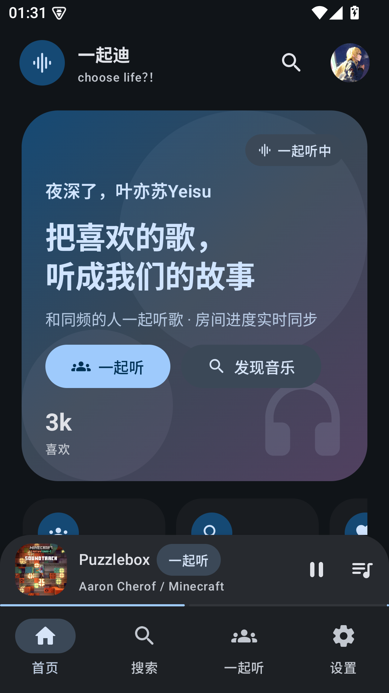
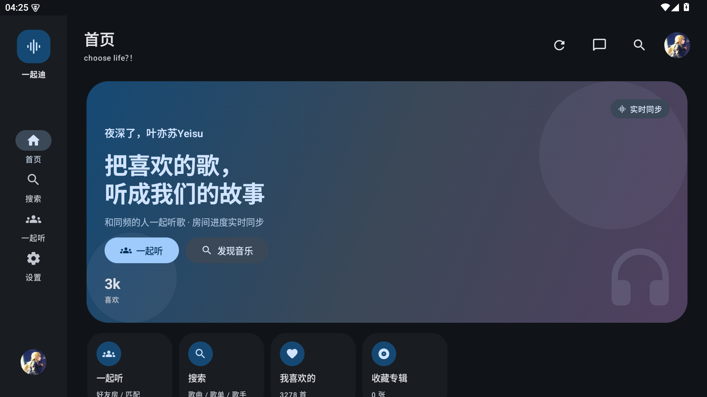
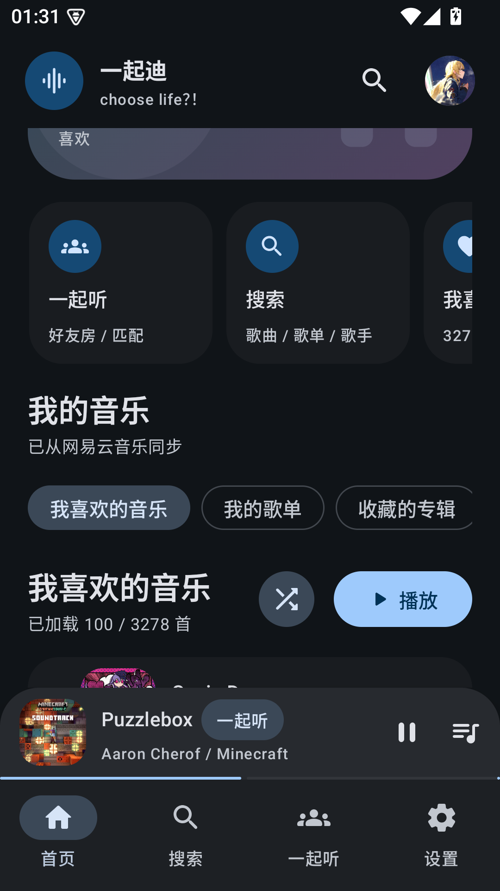
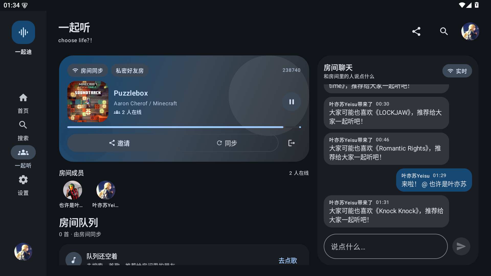
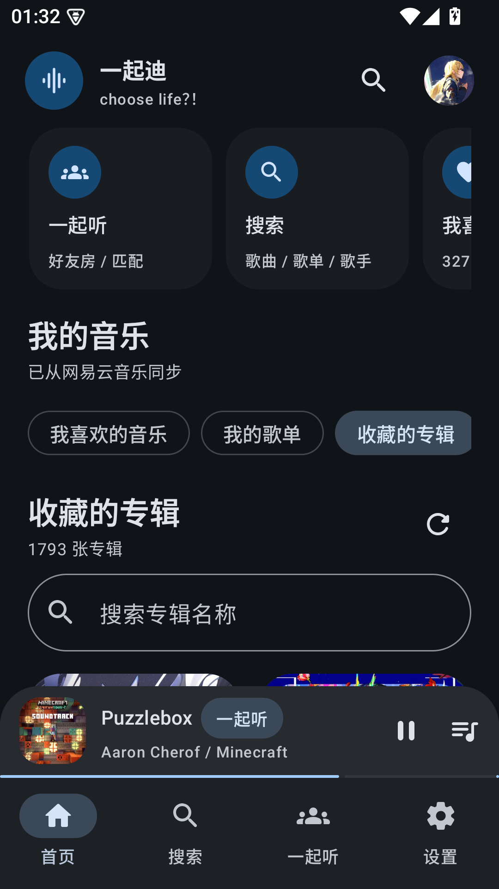
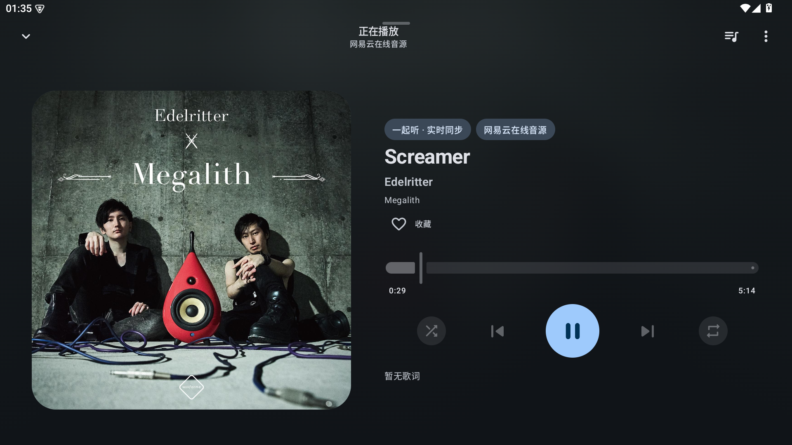
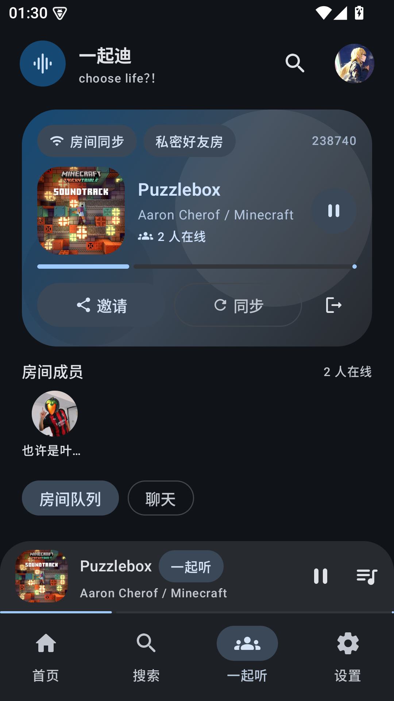
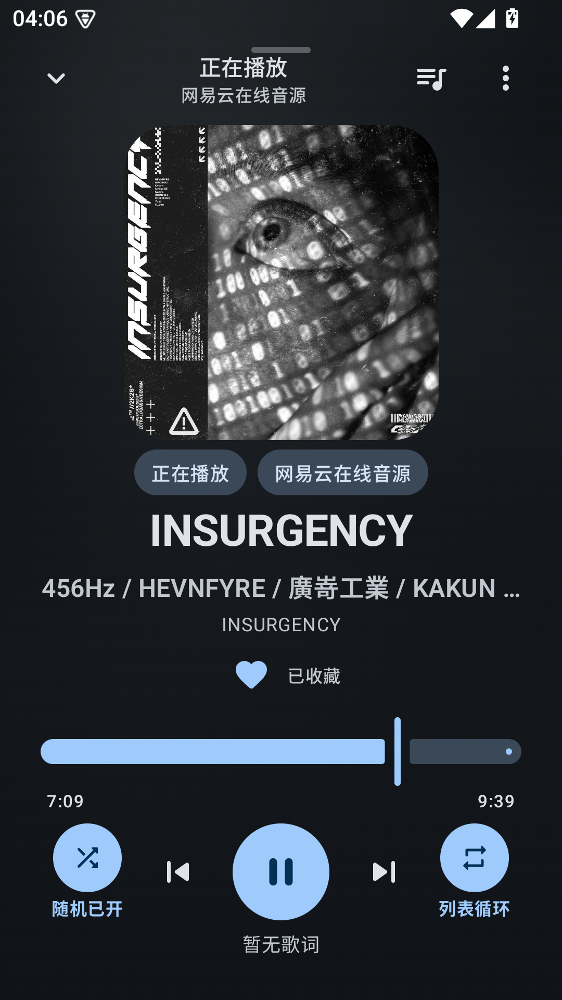
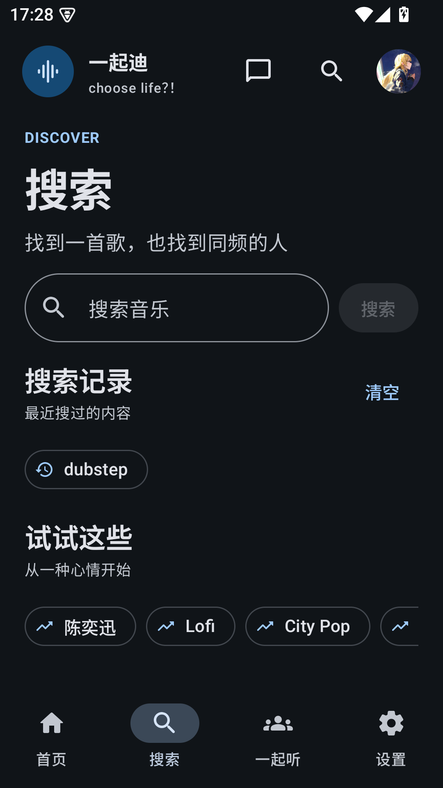
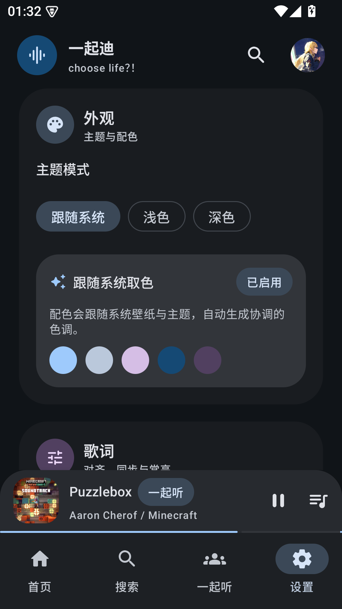

# 一起迪 · Yiqidi

一起迪是 [Music Party](https://github.com/tabidachinokaze/music-party) 的 Android 重写版：用 **Rust** 承载网易云音乐协议、账号、曲库、播放状态机与多人一起听同步，用 **Jetpack Compose** 提供手机与平板两套自适应界面。

当前版本：**1.0.0**（`com.yeisu.yiqidi`，minSdk 26 / targetSdk 35）。

> 包名已从 `dev.yiqidi.mobile` 迁移到 `com.yeisu.yiqidi`。新包是独立应用，旧包会话/本地数据不会自动迁移，首次打开需要重新登录。



## 已实现

- 网易云音乐登录：扫码登录，或手机号 + 短信验证码登录（`sms/captcha/sent` + `w/login/cellphone`）；会话使用 Android Keystore + AES-GCM 加密保存。
- 私信附件：图片、语音、视频；图片走 NOS 分片上传后发 `communication/send/msg`。一起听房间支持图片附件（聊天室 `chatroom/send`）。
- 云信聊天室：集成 NIM Android SDK，用 `/api/middle/im/token-and-chatroom-addr/get` 的账号/票据登录并进入房间聊天室，收到 30005 成员变更时刷新房间、30008 消息同步顶数/赞数、自定义表情消息直接渲染；已实测进入真实好友房并连接成功。
- 曲库：我喜欢的音乐、我的歌单、收藏的专辑；支持搜索、分页、收藏、歌单/专辑详情。
- 播放器：Media3 / ExoPlayer 在线音源、队列、随机/循环、进度、收藏、歌词同步。
- 一起听：官方多人邀请链接解析、房间预览、加入/恢复/离开、心跳同步、成员列表、房间队列、房间聊天（含表情快捷输入）、邀请分享。
- 私信：会话列表、与指定 UID 新建会话、文本收发、10 秒轮询、表情快捷输入；手机单栏、平板双栏；好友发来的一起听分享卡可直接点“加入房间”。
- 搜索：搜索按钮外置不再溢出，支持本地搜索记录、清空记录，清空输入后回到搜索起始页。
- 播放页：下拉跟随手指并平滑退出，不再卡顿后突然收起。
- 底部导航：内容上滑时只收起 dock，迷你播放器保留；底部安全区随主题填充，不出现黑色空隙。
- 添加到歌单：歌曲操作菜单里选择网易云歌单并写入。
- 通知栏：Media3 自定义按钮提供收藏 / 取消收藏，实心与空心爱心随状态切换。
- 播放队列：三点按钮改为垃圾桶图标 + “从队列移除”，队列收起有动画；歌曲菜单关闭也有淡出收起动画。
- 收藏状态：未收藏歌曲显示空心爱心，已收藏显示实心爱心；歌曲菜单会显示“已收藏”。
- 手势与动画：播放页下拉退出、滚动时底部 dock 自动收起、页面/播放器/队列/房间切换均有过渡动画。
- 动态取色：Android 12+ 从系统壁纸取色；低版本回退到内置青绿配色。
- 手机 / 平板两套布局：
  - 手机（< 840dp）：底部导航 + 迷你播放器；播放器全屏；房间内“队列 / 聊天”切换。
  - 平板（≥ 840dp）：左侧 NavigationRail；首页/搜索/设置右侧常驻正在播放面板；一起听为“房间 + 聊天”双栏。
- 已用真实网易云账号和官方多人房间完成邀请预览、加入、同步播放、房间聊天与搜索验证。

## 截图

| 手机 | 平板 |
| --- | --- |
|  |  |
|  |  |
|  |  |
|  | |
|  | |
|  | |
|  | |

## 架构

```text
┌──────────────────────────── 一起迪 Android ────────────────────────────┐
│  Compose (Kotlin)                                                     │
│  Material 3 · 动态取色 · 手机/平板自适应 · Media3 播放                  │
│        │ JNI JSON bridge                    ▲ ui / player / progress     │
│        ▼                                    │                           │
│  core/ (Rust, cdylib)                                                  │
│  网易云 EAPI/WEAPI · 扫码/验证码登录 · Cookie 会话 · 曲库/搜索 · 歌词           │
│  播放状态机 · 一起听协议 · 心跳/队列/聊天 · 房间快照 · 邀请链接校验       │
└───────────────────────────────────────────────────────────────────────┘
```

- `core/` 是纯 Rust：`serde_json`、`ureq`、JNI。核心入口在 `core/src/native.rs`，高级状态机在 `core/src/app/runtime/`。
- `app/` 是 Android 宿主：`MainActivity`、`MusicStore`、Media3 播放服务、Compose 渲染与平台能力（Keystore、分享、二维码、通知）。
- 之所以保留 Kotlin/Compose 渲染层，是因为 Material 3、系统动态取色、Media3 后台播放与 Android 生命周期必须依赖平台原生能力；协议、会话、同步和 UI 状态由 Rust 提供。
- 旧版基于 JSON UI 树的渲染器仍保留在 `RustUiScreen.kt`，当前 `MusicApp.kt` 使用新的 `QiyidiScreen` 全原生 Compose 布局。

## 构建

### 环境

- JDK 17
- Android SDK：platform 35/36、build-tools 35+
- Android NDK：`28.2.13676358`
- Rust stable，已安装：
  - `aarch64-linux-android`
  - `armv7-linux-androideabi`
  - `x86_64-linux-android`
- `cargo-ndk` 4.x

Windows 下可参考：

```powershell
rustup target add aarch64-linux-android x86_64-linux-android
cargo install cargo-ndk
```

在 `local.properties` 写入 SDK 路径（不要提交）：

```properties
sdk.dir=D:\\path\\to\\android-sdk
```

设置 NDK 后构建：

```powershell
$env:JAVA_HOME="C:\\Program Files\\Eclipse Adoptium\\jdk-17.0.21.9-hotspot"
$env:ANDROID_HOME="D:\\path\\to\\android-sdk"
$env:ANDROID_NDK_HOME="$env:ANDROID_HOME\\ndk\\28.2.13676358"
./gradlew.bat :app:assembleRelease
```

Gradle 任务 `cargoAndroid` 会自动对 `arm64-v8a`、`armeabi-v7a` 与 `x86_64` 执行 `cargo ndk build --release`，APK 位于 `app/build/outputs/apk/release/`。

调试构建可直接：

```powershell
./gradlew.bat :app:assembleDebug
adb install -r app/build/outputs/apk/debug/app-debug.apk
```

发布构建的签名材料放在本人机器的 `.local/`（已被 `.gitignore` 排除），仓库不包含私钥。

## ADB 验证

本次使用的两台设备：

| 设备 | ADB 地址 | 分辨率 / 密度 | 用途 |
| --- | --- | --- | --- |
| 手机 | `192.168.1.152:32845` | 1080×1920 / 480 dpi | 手机布局 |
| 平板 | `192.168.1.55:37853` | 1080×1920 / 280 dpi | 平板布局 |

```powershell
adb connect 192.168.1.152:32845
adb connect 192.168.1.55:37853
adb -s 192.168.1.152:32845 install -r dist/Yiqidi-1.0.0-release.apk
adb -s 192.168.1.55:37853 install -r dist/Yiqidi-1.0.0-release.apk
```

用分享 Intent 打开一起听邀请（注意给 URL 加引号，避免 `&` 被 shell 截断）：

```powershell
$link='https://st.music.163.com/listen-together/multishare/index.html?roomId=00cc7491a40f9d0637feb2043e41c53b_1795539238740&inviterUid=1573781080&isFLT=false'
adb -s 192.168.1.152:32845 shell "am start -a android.intent.action.SEND -t text/plain --es android.intent.extra.TEXT '$link' -n com.yeisu.yiqidi/dev.yiqidi.mobile.MainActivity"
```

应用会打开“加入好友房”底部面板；点“预览房间”后会显示邀请人、房间状态和当前歌曲，确认后点“加入房间”即可。

已验证：

- 官方邀请预览返回 `AVAILABLE`，加入后进入真实房间并同步播放。
- 搜索 `Lofi` 返回 30 条结果。
- 房间聊天输入并发送文本（Rust 侧完成 `chatroom/send`）。
- 浅色/深色/跟随系统均生效，配色随系统壁纸变化。
- 手机与平板分别使用 360dp / 1097dp 宽度，自适应为底部导航与 NavigationRail 两套布局。

## 已知边界

私信与添加到歌单已经接入，但仍不是桌面端全部模块的逐项 1:1 移植。当前未包含：

- 自定义表情库已接入：私信用 `communication/send/msg`，房间用 `chatroom/send` 的富表情消息。
- 云信长连接已接入并实测聊天室连接；私信仍是 HTTP 轮询。
- 一起听房间只支持图片附件，语音/视频仅私信支持。
- 私信分页加载更早历史（目前取最近一页）；
- 自定义播放器背景、桌面端的多窗口与本地音乐库；
- 部分桌面版高级设置与自动更新。

后续可按 `core/src/native.rs` 的协议层逐步补齐，而无需重写现有 UI。

## 参考与许可

- 上游桌面项目：[tabidachinokaze/music-party](https://github.com/tabidachinokaze/music-party)（0.13.1）。
- 协议与界面参考：项目随附的 `music-party-0.13.1/docs/`。
- Material 组件参考：`md3-rust/` 下的 `egui-material3`、`iced_md3`、`tauri-plugin-m3` 等项目。
- 上游随附的 `folium-mod-music-party-AGPL-3.0.txt` 已保留在桌面参考项目中；分发衍生版本前请按上游许可处理。
- 依赖：AndroidX Compose Material3、Media3、Coil、ZXing；Rust `ureq`、`serde`、`jni` 等。

本项目仅用于个人学习与自用，请遵守网易云音乐服务条款，不要用于商业分发或大规模自动化请求。
